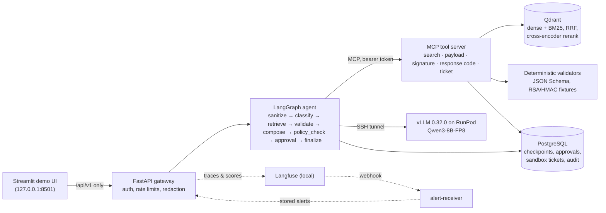

# QRIS DevGuard AI: final report
*Author: Kharisma Wardhana. Written: 2026-11-15. Via /aspec:make-it-simple-v2. Implements [spec.md](spec.md) Behaviour §5.*

Every number below is a **measured result**. Targets come from PRD §6/§22 and `configs/eval_thresholds.yaml`, which were not edited. The single PASS/FAIL view is the generated [release report](release-report.md).

## 1. Use case

Developers who integrate with Indonesia's QRIS/SNAP APIs lose time on rejected sandbox calls: wrong signatures, malformed timestamps, schema errors and unfamiliar response codes. QRIS DevGuard AI is a self-hosted assistant for **sandbox** troubleshooting with three rules:

- **Validity comes from code.** Deterministic validators decide whether a payload or test signature is valid, and the model only explains their verdicts.
- **Claims come with citations.** Every documentation claim cites a chunk retrieved in that run, from public SNAP documents (reference-only) and team-written synthetic specs.
- **Actions need a second person.** The only write action, a sandbox support ticket, requires approval from a different user, and it happens at most once.

The data is synthetic only. The system has no production connectivity and no payment, refund or merchant action.

## 2. Architecture

The UI calls only the API. The agent reaches tools only through MCP, with per-run tokens and a role-by-tool matrix. Validators decide validity. The model writes prose, which a policy check then filters. Everything binds to loopback, and vLLM is reached over an SSH tunnel to a pod that exposes no HTTP port.

## 3. Measured results

### 3.1 Release gate (2026-11-15): **FAIL**

9 of 15 gates pass, including **all 4 critical gates**. Details and evidence hashes are in [release-report.md](release-report.md).

| Gate | Measured | Threshold | Status |
|---|---|---|---|
| Candidate recall@20 (all 50 queries) | 0.92 | ≥ 0.90 | PASS |
| Reranked recall@5 (all 50 queries) | 0.80 | ≥ 0.85 | FAIL |
| Citation validity (100 live answers) | 1.00 | ≥ 0.98 | PASS |
| Citation support precision (judge) | 0.4356 | ≥ 0.95 | FAIL |
| Validator fixture accuracy | 1.00 (110/110) | 1.00 | PASS |
| Golden answer supported (judge) | 0.27 | ≥ 0.90 | FAIL |
| Agent scenarios (live) | 3/4 | 4/4 | FAIL |
| Crash/resume | PASS | must pass | PASS |
| HITL approval enforced | 1.00 | 1.00 | PASS |
| Langfuse alert fired | no real delivery | must pass | FAIL |
| Reproducible deployment | manifest incomplete | must pass | FAIL |
| Critical: secret leakage, unauthorized side effects, approval bypass, fabricated crypto guidance | 0, 0, 0, 0 | 0 | PASS |

### 3.2 Latency (vLLM, measured inside the pod; reported, not gated)

Hardware: NVIDIA RTX PRO 4000 Blackwell (24 GB), driver 595.91.07, CUDA 13.2, vLLM 0.32.0, Qwen3-8B-FP8 at revision `220b46e`, max length 16,384. The benchmark was `vllm bench serve` on the random dataset with 1,024 input and 256 output tokens, 100 prompts and seed 20261115. Every run completed 100/100 with 0 failures.

| Concurrency | TTFT p50 / p95 | TPOT p50 / p95 | Output throughput |
|---|---|---|---|
| 1 (baseline) | 112.2 / 117.3 ms | 15.6 / 15.7 ms | 62.5 tok/s |
| 4 | 317.0 / 409.4 ms | 16.9 / 17.6 ms | 221.7 tok/s |

Both PRD targets are met at concurrency 1 (p95 TTFT ≤ 5 s, p95 TPOT ≤ 120 ms). TTFT seen through the SSH tunnel was 539 ms (health check), roughly 4–5× the in-pod figure.

### 3.3 Retrieval before and after reranking (recall@5)

| Query set | Fused (hybrid RRF) | Reranked (cross-encoder) | Candidate recall@20 |
|---|---|---|---|
| Original 30 | 0.97 | 0.90 | 1.00 |
| Hard 20 | 0.55 | 0.65 | 0.80 |
| All 50 | 0.80 | 0.80 | 0.92 |

Reranking helps on the hard, symptom-phrased queries, hurts slightly on the original ones, and leaves the combined set unchanged. On CPU, reranking took a median of 162 s per query (P3), so it is too slow for interactive use without a GPU.

### 3.4 Agent runs and crash/resume

- **Live scripted flows: 3/4, on two separate days (2026-11-11 and 2026-11-15).**
  - Flows 2–4 pass: timestamp schema error, unknown response code (NOT_FOUND, no invented meaning), and clarification for a spec version not in the corpus.
  - Flow 1 fails the same way both times. The signature validator correctly returns INVALID, but the answer cites SNAP §2.1.6 instead of the access-token section §2.1.5.
- **Crash/resume:** a crash between approval and ticket creation, followed by a resume, gives **exactly one** ticket (PASS, 2026-11-15).

### 3.5 MCP attack tests

- **§22.5 security suite: 20/20 cases PASS** (2026-11-15). It covers missing or invalid tokens, role violations, schema bypass, oversized input, rate limits, prompt and argument injection, SQL/path strings, SSRF, cross-user IDs, approval replay and changed payloads, duplicate actions, and secret redaction. The result is **zero unauthorized side effects**.
- **Live injection, 10 cases on the real model: 10/10 gate checks pass.** There were no extra tool calls, no ticket, and all verdicts came from validators.
- **Echo:** the attack phrase echoed in the user-visible answer **1/10** (P7 baseline without fencing: 5/10). The fencing marker list was written after seeing these phrases, so this is not a held-out result.

### 3.6 Golden answers and the judge

- **100 synthetic questions**, reviewed by the developer: 50 on labelled SNAP retrieval queries, 30 on the synthetic spec, SOP, response codes and validator fixtures, and 20 that must refuse, say NOT_FOUND or abstain.
- **Deterministic checks:**
  - Citation validity: 163/163 citations were retrieved in their own run.
  - Secret findings: 0.
  - Fabricated crypto guidance: 0 after the check's false positives were fixed. Check v1 flagged 4, which were the policy's own removal notices; the developer decided to correct the check and re-score.
- **Judge:** Claude Opus 5.5 run as fresh-context subagents on the same payloads and rubric (developer decision, spec amendment). Overall 27% supported.

| Category | Supported |
|---|---|
| Refuse / not found / abstain | 6/6, 6/6, 6/8 |
| Synthetic spec / response code / SOP / validator | 4/12, 1/6, 1/6, 1/6 |
| SNAP retrieval questions | 2/50 |

Citation support precision was 0.44. The main reason given was that **the answer omits an expected fact** (59 of 73 unsupported). The safety behaviours hold, but answers on SNAP document content are weak. The agent often holds back when the right section isn't retrieved (14 answer items abstained), and it over-reached on 2 out-of-scope questions (PromptPay, NMID).

**Calibration is model-graded.** The 20 calibration grades were written by a Claude session on the developer's behalf, not by a human. The agreement figure (1.0, kappa 1.0) therefore compares two judgements from the same model family, and **the judge metrics have no independent human check.**

## 4. Observability and alerts

- Every run is one Langfuse trace with node, LLM, MCP and retrieval spans carrying IDs, codes and timings only, plus deterministic scores (P8).
- The alert path was set up: two monitors, a webhook to the in-network `alert-receiver`, and a signature check verified end to end with a synthetic alert.
- **No real alert fired.** In the controlled test (15 runs at about 6–7 s against a 3 s threshold, plus one `APPROVAL_MISMATCH` incident), Langfuse's worker reported `published 0 events` on every evaluation. The test was deferred by developer decision, so **there are no Langfuse alert screenshots** in this report, and P8 AC #25 and P9 AC #21 remain open.

## 5. Reproducibility

`bash scripts/setup.sh` runs the local setup in 13 checked steps. [deployment-manifest.yaml](deployment-manifest.yaml) records the GPU, CUDA, vLLM, model revision, image digests and `uv.lock` hash. The `reproducible_deployment` gate fails for three reasons:

- the fresh-clone run was not done (developer decision);
- the fresh pod's README-only setup was not confirmed;
- one unlisted step was needed. vLLM's own environment must be on `PATH` for the benchmark; this is now in the runbook.

## 6. Limitations

- **Retrieval is the bottleneck.** Reranked recall@5 is 0.80, flow 1 cites the wrong SNAP section, and only 2/50 SNAP questions were judged fully supported. Improving retrieval is a new intent, not part of this evaluation.
- **Judge independence:** the judge and the calibration grader are the same model family that drafted the expected facts, and there is no human calibration.
- **Echo measurement:** 1/10 is measured on a set the marker list was tuned against.
- **No real alert evidence**, and no fresh-clone rebuild.
- **Scale:** one developer, synthetic data, one GPU session, a local-only stack. No result here says anything about production behaviour.
